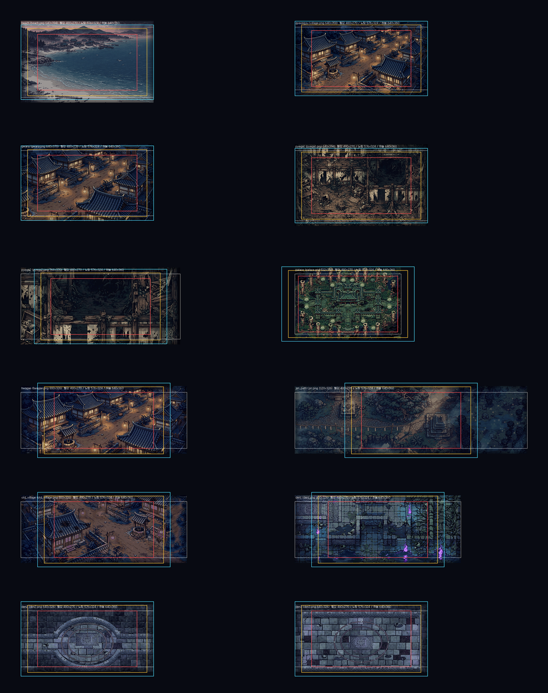

# 시점·카메라 (View & Camera) — "도깨비의세계식 넓은 시야"

> **Status**: Review
> **Author**: 기획팀-시점카메라설계
> **Last Updated**: 2026-10-13
> **Last Verified**: 2026-10-13 — `src/project.godot`(display·stretch), `scripts/level.gd`(카메라·limit·lift·`_cull_lights`·post), `scripts/hud.gd`(터치 좌표), `scripts/player.gd:1163`, `scripts/enemy.gd`(어그로 130), `shaders/post.gdshader`, `scripts/quality.gd`, `art/terrain_import.py`·`art/ch2_terrain.py`, `tests/hud_layout.gd`를 origin/main `ca2e2d1` 기준으로 대조. 프로토타입은 브랜치 `design/view-camera` 의 `--view` 플래그.
> **Implements Pillar**: 3 손가락으로 배운다(조작·가독성) / 화풍 약속(시오브스타즈식 3/4 탑다운 + HD-2D 후처리, `CLAUDE.md`)
> **Rigor**: standard — Overview·사용자 결정·조사·현황·후보·프로토타입·추천·구현 분해·위험·완료 기준·미해결 질문
> **Source**: 사장님 폰 피드백 9번(한 화면 맵이 좁게 느껴짐) · 10번(시점: 바람의나라식 vs 도깨비의세계식) · 사장님 결정 "도깨비의세계 스타일 선호, 그 방향으로 뷰/카메라 잡아줘"(2026-10-13 09:06)

> **문서 성격**: 설계 + 프로토타입 시각화. **게임 기본 동작은 바꾸지 않았다.** `--view` 플래그가 없으면 480×270 현행 그대로이며 이 브랜치는 main 에 머지하지 않는다(설계 승인 후 구현 태스크로 별도 진행).

---

## 1. 요약 (결론 먼저)

**한 줄 결론: 도깨비의세계 방향은 "화풍을 바꾸는 것"이 아니라 "시야를 넓히는 것"이며, 추천은 논리 640×360(정수 3배, 안 B2)을 목표로 하되 에셋 없이 먼저 낼 수 있는 가로 확장(A+)을 1단계로 선행하는 2단계 안이다.**

1. **'도깨비의세계 스타일'로 확인된 것**: 2D 도트 인물 + 3D 느낌 배경의 2.5D, 도트에도 조명·그림자, 비스듬히 높은 각으로 내려다봄, 홍보 샷에서 인물이 화면 높이의 약 5~7%. **미확인**: 실제 플레이 줌, 정확한 각도, HUD 구성, 종횡비 처리(§3). 우리 화풍은 이미 같은 계열이고 우리 처용은 13%라서 달라질 것은 시야 넓이뿐이다.
2. **현황**: 현행 480×270 은 12맵 어디에서도 카메라 범위를 넘지 않고 한 화면이 맵 면적의 42~87%를 보여 준다(가장 좁은 곳: 2장 `jiri_path` 42%, `pyega2` 53%). **긴 폰에서는 화면의 20~31%가 검은 여백**이다(아이폰 가로 2556×1179 에서 4배 → 1920×1080). 2장 6맵은 세로 범위가 이미 100% 라 세로로 늘리려면 지형을 다시 만들어야 한다(§4.6).
3. **후보**: (a) 현행+카메라 보강(변형 A+: 가로만 기기 비율로 확장 — 에셋 0, 시야 +22~25%, 인물·터치 크기 불변, 캡처로 확인) / (b) 논리 해상도 확대(B2 640×360: 시야 ×1.78, 인물 13→10%, 정수 3배로 도트 선명, 단 12맵 전부 지형 재굽기·HUD 확대 필요) / (c) 줌아웃 0.75(B2 와 같은 시야지만 도트가 깨져 **기각**).
4. **추천 = B2, 2단계로**: 1단계 A+·카메라 보강(에셋 0) → 2단계 B2(지형 재굽기·UI 확대, 사장님 폰 확인 게이트). B2 의 결정적 이유는 위·아래에서 오는 요괴가 화면에 들어오자마자 추격을 시작하는 현재 문제(어그로 지름이 화면 높이의 96%)를 72%로 풀어 주는 것이 세로 시야뿐이기 때문이다(§4.5·§7). 재굽기 비용이 부담이면 1단계에서 멈추는 것도 합리적이다.
5. **가장 큰 위험**: B2 에서 처용·UI 가 폰에서 25% 작아짐(교대 버튼 37pt→28pt), 12맵 지형 재굽기 좌표 이동, **폰 캔버스 픽셀 기준(기기 px vs CSS px)이 미확인**.
6. **게임 동작은 바꾸지 않았다.** 프로토타입은 `--view=a2|bkh|b576|b640|c75` 플래그(기본값 무변경, `tests/hud_layout.sh` PASS 확인)이며 비교 이미지는 `production/qa/view-proto/cmp_*.png`.

---

## 2. 사용자 결정과 문제 정의

| 항목 | 내용 |
|---|---|
| 피드백 9 | 한 화면에 보이는 맵이 좁다 → 뷰 확대/줌아웃 검토 |
| 피드백 10 | 시점 고민: 바람의나라식 vs 도깨비의세계식 |
| 결정 | **도깨비의세계 스타일 선호**, 그 방향으로 뷰/카메라 |
| 풀어야 할 것 | (1) '도깨비의세계 스타일'이 구체적으로 무엇인지 확인된 범위만 정리 (2) 현재 화면이 맵의 몇 %를 보여주는지 (3) 시야를 넓히는 후보 3안의 비용·위험 (4) 추천 1안 + 구현 분해 |

---

## 3. '도깨비의세계' 조사 (확인된 것 / 미확인)

조사 방법: 웹 검색(Firecrawl)으로 기사 3건 열람 + 공식 공개 스크린샷 2장을 직접 내려받아 육안·측정. 확인 못 한 것은 추측하지 않고 **미확인**으로 둔다. (Firecrawl 크레딧이 거의 없어 추가 수집은 못 했다.)

### 3.1 확인된 것

| 사실 | 근거 |
|---|---|
| 슈퍼캣 개발 · 카카오게임즈 서비스, PC·모바일 MMORPG, 2026-10-08 출시. 슈퍼캣은 '바람의나라: 연' 개발사 | 인벤 프리뷰 2026-10-06 (`inven.co.kr/webzine/news/?news=321802`), 지디넷코리아 2026-10-02 |
| **2D 도트 캐릭터 + 3D 배경을 결합한 2.5D 그래픽**. 도트 캐릭터에도 3D 조명·그림자를 적용해 "캐릭터와 배경이 같은 공간에 있다"는 느낌을 낸다 | 인벤 프리뷰, 지디넷코리아 2026-06-09(`v.daum.net/v/GS8BsPPKNG`) |
| 배경은 기와 건물·초가집·장승·성문·대나무 숲·무덤 등 입체 구조물(마을 '타바로', 사냥터 '귀수사', '귀택' 폐허) | 지디넷코리아 2026-06-09 |
| **카메라는 비스듬히 높은 각에서 내려다본다**(공개 스크린샷 2장 육안). 지붕 윗면·성벽 윗면과 앞면이 함께 보임 | 인벤 공식 이미지 `i1621667954.jpg`(1600×928), 지디넷 이미지(640×371) |
| **캐릭터가 화면에서 작다**: 서 있는 인물 키가 화면 높이의 **약 5%**(1600×928 샷에서 45~50px; 640×371 샷에서 25~28px ≈ 7%) — 한 장면에 건물 3~4채·성벽 전체·수로까지 들어옴. 인물은 머리가 큰 2.5~3등신 | 위 스크린샷 직접 측정(홍보용 프레이밍, 실제 플레이 줌은 아님 — 3.2 참조) |

### 3.2 미확인 (추측 금지)

| 미확인 | 영향 | 확인 방법 |
|---|---|---|
| 실제 플레이 화면의 줌 거리·한 화면에 담기는 월드 크기, 줌을 플레이어가 조절하는지 | 우리 목표 배율을 "5%"로 잡을지 | 사장님이 직접 플레이한 스크린샷/영상 1~2장(폰) |
| 카메라 각도(정확한 피치 °), 직교인지 원근인지 | 우리는 직교 + 깊이 압축 K=0.75 (≈41°) 로 고정 | 같은 방법 |
| 조이스틱·버튼·미니맵 등 HUD 구성과 크기 | HUD 설계 | 같은 방법(홍보 이미지엔 HUD 없음) |
| 해상도·종횡비 처리(레터박스/확장), 정수 배율 여부 | 우리 3안 선택 | 확인 불가에 가깝다(비공개) |
| '바람의나라' 쪽 화면 구성 | 비교 대상 | 이번엔 조사하지 않음(사장님이 이미 도깨비의세계로 결정) |

### 3.3 우리 게임과의 위치 (확인된 범위의 비교)

- **화풍은 이미 같은 계열이다.** 우리 화면(`CLAUDE.md` "시오브스타즈식 3/4 탑다운 + 옥토파스식 HD-2D")도 도트 캐릭터 + 입체 느낌의 일러스트 지형 + 조명·그림자·심도 후처리를 쓰고, 카메라는 K=0.75 로 비스듬히 내려다본다. 즉 "도깨비의세계 스타일"로 바꿔야 할 핵심은 **화풍이 아니라 '시야의 넓이(배율)'** 라는 것이 확인된 범위의 결론이다.
- **배율 차이는 크다.** 우리 처용은 약 36px 인물이 270px 화면에서 **13%**, 도깨비의세계 홍보 샷은 **약 5~7%**. 같은 비율까지 가려면 논리 높이가 ~540~720(지금의 2~2.7배)이어야 하는데, 이는 현재 지형 일러스트(맵당 640~1120 × 약 330px 그림)와 도트 크기로는 불가능하다(§7). **현실적 목표는 "지금보다 1.33~1.8배 넓게"** 이고, 완전한 배율 일치는 추구하지 않는다.
- 홍보 샷은 마을 전경을 일부러 넓게 잡은 것일 수 있고(프레이밍), 모바일 실제 플레이는 더 가까울 가능성이 있다. 이 문서는 그 가능성 때문에 목표를 "5%"가 아니라 "10%(B2)" 선으로 잡는다.

---

## 4. 현황 조사

### 4.1 화면 설정 (`src/project.godot`)

| 항목 | 값 |
|---|---|
| 논리 해상도 | 480×270 (`window/size/viewport_*`), 창 960×540 |
| 스트레치 | `mode="viewport"`, `scale_mode="integer"`, aspect 기본(keep = 레터박스) |
| 방향 | 가로 고정(`orientation=0`) |
| 렌더 | GL Compatibility, `snap_2d_transforms_to_pixel=true`, 기본 텍스처 필터 nearest |
| 웹 | `canvas_resize_policy=2`(적응), `allow_hidpi` 미지정(엔진 기본값 — **폰에서 캔버스 픽셀이 기기 px 인지 CSS px 인지는 미확인**, §9 Q3) |

### 4.2 카메라 (`level.gd` + `player.tscn`)

- `Camera2D` 는 처용의 자식, `position=(0,-16)`(발밑에서 16px 위), 위치 스무딩 6, **zoom 1**.
- 가동 범위(레벨 로드 시): `limit_left=0`, `limit_right=size[0]`, `limit_top=-2·tier(-52)`, `limit_bottom=size[1]-tier`. **화면 가장자리가 이 범위를 넘지 못한다** → 가로 W=`size[0]`, 세로 H=`size[1]+tier` = **지형 PNG 높이 − 56**. (한 화면이 맵 범위보다 크면 Godot 이 범위를 맞추지 못해 맵 밖 빈 공간이 보인다.)
- `lift(footprint)`: 화면 y = footprint y × **K(0.75)** − 단차×26. 지형은 PNG 한 장을 `(0,-82)` 에 그린다. 모든 게임 좌표는 발밑 좌표이고 화면 좌표로 변환해서 쓴다.
- 시야 판정이 480×270 에 묶인 곳: `player.gd:1163`(천지울림 스킬 "화면 전체" 판정 사각형 `Rect2(.., Vector2(480,270))` 고정). 라이트 컬링은 이미 뷰포트·zoom 에 따라 계산(`level.gd _cull_lights`).

### 4.3 HUD·터치 (`hud.gd`, `tests/hud_layout.gd`)

- 전부 480×270 절대 좌표. 터치 버튼(중심, 터치 반경): 베기(430,222;24) 구르기(384,244;22) 부적(394,196;20) 노래(438,172;22) 춤(396,150;22) 교대(360,186;14) 메뉴(462,16;18). 조이스틱 대기 위치 (70,214), 상태 막대 좌상단 (6~130, 5~40), 보스 막대 중앙 x=240, 토스트 폭 480, 일시정지 배경 480×270, 대화창 (20,188).
- 480/270/240 리터럴이 있는 곳: `hud.gd`(137·309·528), `intro.gd`(36·123·150·186·193·203·238), `title.gd`(40·49·87·103), `dialog_box.gd`(45·204 등), `player.gd:1163`. 인트로·타이틀 그림은 480×270 기준으로 그려져 있다.
- `tests/hud_layout.gd`: 터치 반경끼리 겹침 없음(h1), 화면 밖 4px 초과 안 나감(h2: 480/270 하드코딩), 버튼 그림 겹침(h3), 가장자리 여백 6px(h4), 부적 이름표(h5), 메뉴-상태막대(h6), 좌상단 HUD(h7), 타이틀 고지문(t1~t5). 시작 시 해상도를 인자로 받지 않는다.

### 4.4 후처리·성능 (`shaders/post.gdshader`, `quality.gd`, `production/qa/perf-m1.md`)

- post 셰이더는 전체 화면 ColorRect 한 장. 심도(틸트시프트)는 **화면 높이 비율(focus_y=0.56, 처용 행)** 로 계산하므로 해상도가 달라도 구도는 같다(블러 반경은 mip 단계라 논리 px 기준 → 넓은 뷰에서는 상대적으로 약해 보임, 튜닝 후보). 블룸·비네트·안개도 uv 기준.
- 비용은 라이트가 최대(화면 안 라이트 × 노멀맵 스프라이트가 라이트마다 재그림, gyeongju 라이트 20개). 등급 폴백(Quality): 라이트 상한 상 무제한/중 6/하 3, 블룸·노멀맵 off. 이미 시야 밖 라이트는 컬링.
- 기존 측정(perf-m1): 드로우콜 30~76, 맵당 텍스처 13.5MB, 후처리는 480×270 에서 돌아 채움률 부담이 작음.

### 4.5 전투 가독성 현황

- 요괴 어그로 반경 **130px**(화면 좌표 기준, `enemy.gd:266`). 480×270 에서 이 원의 지름 260 은 화면 **높이의 96%**, 폭의 54%. 처용은 화면 높이의 56%(151px) 줄에 서므로 위쪽 어그로 가장자리가 화면 위 가장자리(151px)에 사실상 닿는다 → **위·아래에서 오는 요괴는 화면에 들어오자마자(또는 들어오기 직전에) 추격을 시작한다**(예고 읽을 여유가 가로 쪽보다 훨씬 적다).
- 처용 도트 인물 높이 약 36px(프레임 64×64 셀) → 화면 높이의 13.3%.

### 4.6 맵별 지형 PNG와 한 화면 점유율 (1장 6맵 + 2장 6맵)

규칙(§4.2): 카메라 가동 범위 W×H = `size[0]` × (PNG 높이 − 56). 셀 = 한 화면의 가로 점유 / 세로 점유. **초과 = 뷰가 맵 범위보다 커서 맵 밖 빈 공간이 보이는 px**. (생성: `production/qa/view-proto/analyze.py`)

셀 = 가로 점유 / 세로 점유 (맵 가능 범위 대비 한 화면). 초과 = 뷰가 맵 범위보다 커서 맵 밖 빈 공간이 보이는 픽셀 수(가로+/세로+).

| 장 | 맵 id | 지형 PNG | 카메라 가동 범위 W×H | A 480×270 | B1 576×324 | B2 640×360 | B2 지형 보강 필요(폭/높이) |
|---|---|---|---|---|---|---|---|
| 1 | beach | 640x394 | 640×338 | 75% / 79% (면적 59%) | 90% / 95% (면적 86%) | 100% / 100% **초과 가로+0 세로+22** | 폭 +0 / 높이 +22 |
| 1 | gyeongju | 640x358 | 640×302 | 75% / 89% (면적 67%) | 90% / 100% **초과 가로+0 세로+22** | 100% / 100% **초과 가로+0 세로+58** | 폭 +0 / 높이 +58 |
| 1 | gwana | 640x370 | 640×314 | 75% / 85% (면적 64%) | 90% / 100% **초과 가로+0 세로+10** | 100% / 100% **초과 가로+0 세로+46** | 폭 +0 / 높이 +46 |
| 1 | pyega1 | 640x394 | 640×338 | 75% / 79% (면적 59%) | 90% / 95% (면적 86%) | 100% / 100% **초과 가로+0 세로+22** | 폭 +0 / 높이 +22 |
| 1 | pyega2 | 768x370 | 768×314 | 62% / 85% (면적 53%) | 75% / 100% **초과 가로+0 세로+10** | 83% / 100% **초과 가로+0 세로+46** | 폭 +0 / 높이 +46 |
| 1 | palace | 512x346 | 512×290 | 93% / 93% (면적 87%) | 100% / 100% **초과 가로+64 세로+34** | 100% / 100% **초과 가로+128 세로+70** | 폭 +128 / 높이 +70 |
| 2 | hwagae | 800x326 | 800×270 | 60% / 100% (면적 60%) | 72% / 100% **초과 가로+0 세로+54** | 80% / 100% **초과 가로+0 세로+90** | 폭 +0 / 높이 +90 |
| 2 | jiri_path | 1120x326 | 1120×270 | 42% / 100% (면적 42%) | 51% / 100% **초과 가로+0 세로+54** | 57% / 100% **초과 가로+0 세로+90** | 폭 +0 / 높이 +90 |
| 2 | old_village | 800x326 | 800×270 | 60% / 100% (면적 60%) | 72% / 100% **초과 가로+0 세로+54** | 80% / 100% **초과 가로+0 세로+90** | 폭 +0 / 높이 +90 |
| 2 | den1 | 800x326 | 800×270 | 60% / 100% (면적 60%) | 72% / 100% **초과 가로+0 세로+54** | 80% / 100% **초과 가로+0 세로+90** | 폭 +0 / 높이 +90 |
| 2 | den2 | 640x326 | 640×270 | 75% / 100% (면적 75%) | 90% / 100% **초과 가로+0 세로+54** | 100% / 100% **초과 가로+0 세로+90** | 폭 +0 / 높이 +90 |
| 2 | den3 | 640x326 | 640×270 | 75% / 100% (면적 75%) | 90% / 100% **초과 가로+0 세로+54** | 100% / 100% **초과 가로+0 세로+90** | 폭 +0 / 높이 +90 |

뷰가 맵 범위를 넘는 맵 수(12맵 중): A 480x270 0, B1 576x324 10, B2 640x360 12

읽는 법과 결론:
- **현행 A(480×270)는 어느 맵에서도 범위를 넘지 않는다.** 가로 점유 42~93%, 면적 42~87%. 가장 좁은 곳은 2장 `jiri_path`(42%) 와 `pyega2`(53%)·`hwagae`/`old_village`/`den1`(60%).
- **2장 6맵은 세로가 이미 100%**(PNG 326 → 가동 범위 270 = 뷰 높이). 즉 2장은 세로로 더 넓히는 안(B1·B2·C)이면 **전부 맵 밖 빈 공간**이 보이고, 가로로만 넓히는 안은 안전하다.
- 1장 맵은 가로 640 이 많아 640 폭까지는 안 넘는다. 예외: `palace` 512(가장 좁은 맵), `pyega2` 768.
- 지형은 Drive 일러스트(1920×1280) 한 장에서 맵 크기로 잘라 만든 것이라(`art/terrain_import.py` cover-fit, 2장은 `art/ch2_terrain.py` S=2.4 합성) **소스에 세로 여유 행이 있다**: beach·pyega1 33행(필요 +22), gyeongju 69행(필요 +58), gwana·pyega2 100행↑, 2장은 소스 1280행 대비 416px×2.4=998행(사용 782행) 이내. 단 **palace 는 폭 자체가 512 라 640 폭이 되면 배율이 바뀐다**(소스 여유 11행뿐). → 재굽기는 가능하지만 **그림이 이동하므로 충돌·소품·NPC·조명 좌표를 전부 다시 맞춰야 한다**(§7·§8).

---

## 5. 후보 설계

모든 안은 **도트 정수 배율 유지**를 전제로 비교했다(비정수 배율은 C 안 하나뿐이고 그 위험을 평가한다).

### 5.0 비교 기준 기기와 계산 방법

기준 기기는 사장님 폰 모델이 **미확인**(개발 체크리스트의 393×852pt 를 대표로 사용) 이라 4가지 가로 화면을 같이 본다. 정수 배율 = `floor(min(기기W/논리W, 기기H/논리H))`. 

| 기기(가로, 기기 px) | A 480×270 | A+ 가로 확장 | B1 576×324 | B2 640×360 | C(480×270 렌더) |
|---|---|---|---|---|---|
| 아이폰 393×852pt@3x (**2556×1179**) | 4배 → 1920×1080, 좌우 318·상하 49 여백, **화면 69%** | 4배, 논리 585×270, 2340×1080, 좌우 108·상하 49, **84%** | 3배 → 1728×972, 좌우 414·상하 103, **56%** | 3배 → 1920×1080, 좌우 318·상하 49, **69%** | 4배, **69%** |
| 갤럭시류 (2400×1080) | 4배, 좌우 240, **80%** | 4배, 논리 600×270, **100%** | 3배 1728×972, **65%** | 3배 1920×1080, 좌우 240, **80%** | 4배, **80%** |
| 1080p (1920×1080) | 4배 **100%** | 4배(480 그대로) 100% | 3배 81% | 3배 **100%** | 4배 100% |
| 저가폰 720p (1280×720) | 2배 960×540 **56%** | 2배, 논리 480×270(가로 확장 없음) → 960×540 **56%** | 2배 81% | 2배 **100%** | 2배 56% |

수치 해석:
- **현행 A 는 긴 폰에서 화면의 31%(아이폰)·20%(갤럭시)를 검은 여백으로 버린다.** "맵이 좁게 느껴짐"의 상당 부분이 이것이다(월드 자체의 좁음과 별개). A+ 는 같은 도트 크기(4배)를 유지하면서 이 여백을 월드로 채운다.
- **B2 640×360 은 1080p·720p 에서 정확히 꽉 찬다**(16:9 유지). 576×324 는 3배에서 어느 기기에서도 기기를 꽉 채우지 못한다(B1 은 정수 배율 관점에서 손해).
- 처용이 **폰에서 실제로 보이는 크기**(아이폰 2556×1179 기준, 인물 36px): A·A+ 144px(화면 높이의 12.2%, 약 8mm) / B1·B2·C 108px(9.2%, 약 6mm).

### 5.1 (a) 현행 480×270 유지 + 카메라 보강 — "A", 선택 변형 "A+"

- **A(최소안)**: 해상도 그대로, 카메라만 보강 — ① 이동 방향 **룩어헤드**(진행 방향으로 최대 64×40px 미리 내밈, 스무딩 0.06) ② **전투 프레이밍**(어그로 상태의 가장 가까운 요괴 쪽으로 최대 24px) ③ 보스방 카메라 고정/연출 범위 ④ 데드존(처용이 화면 중심 ±16px 안에서는 카메라 정지, 잔떨림 감소). 월드가 보이는 양은 룩어헤드 쪽으로 최대 +64px 정도(실질 가로 뷰 480→544 방향성). 에셋·좌표 변경 0.
- **A+(제안 변형, 이번 조사에서 발견): 가로만 기기 비율로 확장 — `content_scale_aspect = KEEP_HEIGHT`.** 높이는 270 으로 고정하고 가로가 기기 비율만큼 늘어난다. 도트는 4배 그대로라 선명도·처용 크기·터치 크기가 현행과 같고, 아이폰 585×270·갤럭시 600×270 이 되어 **여백이 줄고 가로 시야가 +22~25%**. **세로 지형 재제작이 필요 없다.** 가로가 모자라는 맵은 palace(512) 하나뿐(맵별로 논리 폭 상한을 두면 해결, §8).
  - 캡처로 확인됨: 갤럭시 2400×1080 창에서 `--view=bkh` 가 600×270 뷰포트(정수 4배)를 만든다(`production/qa/view-proto/`).
  - 한계: 논리 높이가 270 그대로라 **세로 시야·위아래 어그로 여유(§4.5)는 개선되지 않는다.** 폰 종횡비가 다양해 시야가 기기마다 다름(상한 640 필요).

### 5.2 (b) 논리 해상도 확대 — "B1 576×324" / "B2 640×360"

같은 스프라이트·같은 도트 크기로 논리 해상도만 키운다. 정수 배율로 올려 폰에서는 3배(아이폰·갤럭시) 또는 2배(저가폰)로 표시.

- 면적 **B1 1.44배 / B2 1.78배**. 처용은 논리 36px 그대로이고 화면에서 25% 작아짐(4배→3배).
- 도트 선명도: 정수 배율이므로 **선명도 유지**(도트 하나가 3×3 기기 px). 4배보다 입자가 작아 보일 뿐이다.
- **지형 PNG 한계가 핵심 비용**(§4.6): B2 는 12맵 전부, B1 은 10맵이 뷰가 맵 범위를 넘는다(세로 +10~+90, palace 가로 +64~128). 해결: ① **재굽기**(소스에 여유가 있어 가능, 좌표 시프트·충돌 재검증 필요) ② 임시: 맵 가장자리 안개/수묵 번짐으로 빈 공간 처리(가장자리가 정직해 보이게).
- 폰 UI: 같은 로직 좌표 그대로면 모든 터치 버튼이 물리적으로 25% 작아진다(아이폰 3배 기준 베기 64pt→48pt, 교대 r14=37pt→28pt(HIG 최소 44pt 미달), 메뉴 48pt→36pt). → UI 확대(§8) 또는 양옆 여백 활용 필요.
- 성능: 픽셀 1.78배(후처리 포함), 화면 안 월드 오브젝트·라이트 ≈1.8배(등급 폴백이 상한을 두므로 하 등급은 변화 없음). 측정은 §6.

### 5.3 (c) 카메라 줌아웃 — "C" (zoom 0.75, 480×270 렌더 유지)

스프라이트·지형을 0.75배로 줄여 640×360 월드를 480×270 렌더에 담는다.

- **픽셀 퍼펙트가 깨진다**: 도트 0.75배 nearest 는 4픽셀 중 1열·1행이 불규칙하게 빠져(걸을 때 깜빡임·외곽선 끊김), linear 는 번져 도트 화풍이 무너진다. 이동 중 서브픽셀 위치가 바뀌면 빠지는 열이 움직여 **물결치듯 일렁인다**(정지 캡처에서도 처용 확대 비교 이미지에서 확인 — §6).
- B2 와 시야·인물 크기는 같은데(둘 다 640×360 월드, 처용 108px) 화질만 나쁘고, UI 는 480×270 그대로라 UI 크기 문제가 없다는 점만 이득. 지형 PNG 부족 문제는 B2 와 동일.
- 결론: **줌아웃은 B2 의 열화 버전**. 비정수 배율을 UI 가 아니라 월드에 적용하는 것이라 가장 눈에 띈다. 채택하지 않는다(단, 보스 연출 등 일시적 줌은 도트가 아니라 일러스트·후처리에서만 허용 — §10).

### 5.4 안별 평가표

| 항목 | A 현행+카메라 | **A+ 가로확장** | B1 576×324 | **B2 640×360** | C 줌아웃 0.75 |
|---|---|---|---|---|---|
| 시야 면적(현행=1) | 1.0 (+룩어헤드) | **1.22~1.25** (585/600×270) | 1.44 | **1.78** | 1.78 |
| 도트 선명도 | ◎ 4배 | ◎ 4배 | ○ 3배 | ○ 3배 | **✕ 0.75배(깨짐)** |
| 처용 폰에서 크기 | 144px (기준) | 144px | 108px (−25%) | 108px (−25%) | 108px |
| 폰 화면 활용(아이폰/갤럭시) | 69/80% | **84/100%** | 56/65% | 69/80% | 69/80% |
| 지형 PNG 부족 | 없음 | palace 폭만 | 10맵 세로+, palace 가로 | **12맵 세로+, palace 가로** | 12맵(B2와 같음) |
| HUD·터치 | 변경 없음 | 우측 앵커링만 | **전체 재배치+확대** | **전체 재배치+확대** | 변경 없음 |
| 위·아래 어그로 여유(§4.5) | 96% (여유 없음) | 96% (동일) | 80% | **72%** | 72% |
| 전투 판독(요괴 예고 크기) | 현행 | 현행 | −25% | −25% | −25%+도트 깨짐 |
| 성능(픽셀) | 1.0 | 1.22~1.25 | 1.44 | 1.78 | 1.0(렌더) |
| 기존 에셋 재사용 | 전부 | 전부(palace 폭 보강) | 지형 재굽기, 스프라이트 전부 | 지형 재굽기, 스프라이트 전부 | 지형 재굽기 |
| 구현 규모 | 소 | **소~중** | 대 | 대 | 중(그러나 화질 문제) |
| 도깨비의세계 방향 | 낮음 | 중간 | 중간 | **높음** (인물 9%) | 높음(화질 ✕) |

---

## 6. 프로토타입 시각화

### 6.1 방법
`src/scripts/capture.gd` 에 `--view=<안>` 플래그만 추가했다(기본값 무변경): `a` 현행 / `a2` 룩어헤드 / `bkh` 가로 확장(`content_scale_aspect=KEEP_HEIGHT`, `--winsize=` 로 기기 창 크기 흉내) / `b576`·`b640` 논리 해상도 확대 / `c75` 카메라 zoom 0.75. 터치 버튼은 프로토에서만 우측·하단으로 임시 이동(`hud.gd _apply_view_proto`). 같은 장면을 `production/qa/view-proto/capture.sh` 로 안마다 캡처(원본 `raw/`), `compose.py` 가 **아이폰 가로 2556×1179 화면에 정수 배율 nearest 로 올린 모습**(여백 포함)으로 합성해 칸마다 안 이름·논리 해상도·배율·폰 화면 사용률을 표기했다. 중요: 칸들은 같은 비율로 줄였으므로 **처용·건물의 크기 차이가 폰에서 실제로 보이는 크기 차이**다.

### 6.2 비교 이미지 (직접 열어 확인함)
| 파일 | 내용 | 확인된 점 |
|---|---|---|
| `cmp_s1_village.png` | 경주 변두리 같은 위치, 5안 | A 는 폰 화면의 68%만 쓰고 좌우 검정. **A+ 는 585×270 으로 83%를 쓰며 양옆 풍경이 더 보임(도트 크기 동일)**. B1·B2 는 월드가 넓어지고 인물이 작아짐. B2 는 맵 아래쪽 약 30px 이 맵 밖 빈 공간(§4.6 초과 +58)으로 어둡게 보임 |
| `cmp_s3_palace.png` | 폭 512 의 월성 편전 | A+/B1/B2 에서 **맵 좌우 밖 빈 공간이 그대로 노출**됨 — 맵별 폭 상한(V-P5)이 필요한 이유 |
| `cmp_s4_combat.png` | 요괴가 달려드는 순간 | 전투 판독: B 계열은 처용·요괴가 작아지지만 위·아래 여유가 늘어남 |
| `cmp_s5_touch.png` | `--touch` UI | B 계열에서 버튼이 물리적으로 25% 작아짐(프로토는 위치만 앵커링, 확대 안 함) |
| `cmp_s2_hwagae.png` | 2장 화개 저자(폭 800) | A+ 가 가로로 큰 이득, B 계열은 세로가 맵 밖(초과 +54/+90) |
| `cmp_aggro.png` | 어그로 반경 130px 빨간 원 | A: 원이 화면 높이를 거의 채움(96%) → B2: 72% |
| `cmp_hero_crop_s1_village.png` | 처용 확대 | C(0.75)는 스프라이트 축소로 픽셀 열·행이 불규칙하게 빠짐 — 채택 불가 근거 |
| `map-coverage.png`, `map-table.md` | 12맵 지형 위 뷰포트 사각형·점유율 표 | §4.6 |

### 6.3 측정 확인값
- `--view=bkh` 로 아이폰 2556×1179 창 → 뷰포트 **585×270, 표시 배율 4.0**(정수 유지), 갤럭시 2400×1080 → **600×270, 4배**(캡처 로그 `VIEWPORT size=… display_scale=4.0`). 정수 배율 모드와 KEEP_HEIGHT 가 함께 동작한다.
- `--view=b640` → 뷰포트 640×360.
- 기본 실행은 변경 없음: 변경 코드는 전부 `view_mode != "a"` 또는 `Capture.view_zoom != 1.0` 가드 안이고, `tests/hud_layout.sh` 는 `HUD_LAYOUT PASS`.
- 한계: 캡처는 xvfb 소프트웨어 렌더. 성능 수치(드로우콜·라이트)는 `perf.sh` 로 상대 비교하도록 스크립트만 준비했고 폰 ≥30fps 는 사용자 폰 확인이 필요하다(§9 R4). 룩어헤드(a2)는 `cmp`에 넣지 않고 `raw/s6_walk_a2.png` 로만 남겼다.

---

## 7. 추천안

### 7.1 추천 — (b) 논리 640×360 + 정수 3배, 2단계로 낸다

| 단계 | 내용 | 에셋 |
|---|---|---|
| **1단계 (즉효)** | A+ 가로 확장(높이 270 고정, 폭 = clamp(기기 비율, 480, 맵 폭)) + 카메라 보강(룩어헤드·데드존·전투 프레이밍) + 씬별 화면 모드(타이틀·인트로는 `KEEP`) + HUD 우측 앵커링 | 없음(palace 는 폭 상한) |
| **2단계 (본안)** | 논리 높이 360(B2). 12맵 지형 재굽기(PNG 높이 ≥416) + 좌표 이동 보정 + HUD·터치 확대 + 어그로·판독 재튜닝 | 지형 12맵, UI |

**이유(확인된 근거만):**
1. 사장님이 고른 방향의 실체는 배율 차이다(§3.3). 인물 비율 13% → A+ 13% → **B2 10%**(홍보 샷 5~7%). B2 는 현재 에셋으로 갈 수 있는 한계 근처이고 그 이상은 도트·지형 해상도를 다시 만들어야 한다.
2. **세로 시야가 병목**이다. 위·아래 요괴는 화면에 들어오자마자 어그로(지름이 화면 높이의 96%). A+ 는 못 풀고 B2 는 72%로 약 50px 예고 여유를 준다(`combat-strategy.md` "예고를 읽는다"와 일치).
3. 2장은 세로 범위가 이미 100% 라 가로(A+, 공짜)와 세로(B2, 재굽기 비용)를 단계로 나누는 것이 맞다.
4. 정수 배율 유지(1080p·720p 정확히 꽉 참). 줌아웃(C)은 도트가 깨져 기각, B1(576×324)은 3배에서도 폰을 꽉 채우지 못하고 비용은 B2 와 같아 기각, A 단독은 "좁음"을 거의 못 푼다.
5. 재굽기 가능성: 지형은 Drive 일러스트(1920×1280) cover-fit 이라 소스에 세로 여유 행이 있다(§4.6). 단 합성 로직·좌표 이동량은 **아트팀 확인 필요(미검증)**.

**대안**: 재굽기가 부담이면 1단계(A+)에서 멈추고 2장 신규 맵부터 B2 로 간다(Q1).

### 7.2 '도깨비의세계 스타일' 반영 범위 (확인된 것만)
2D 도트 + 3D 느낌 배경 + 캐릭터 조명·그림자: 이미 구현(변경 없음). 비스듬한 내려다봄: 이미 K=0.75(각도 변경은 범위 밖). 인물이 작고 건물 여러 채가 한 화면: **시야 확대가 이 문서의 본체**. 미확인(HUD·줌 조절·종횡비 처리)은 따라 하지 않는다.

---

## 8. 구현 작업 분해
> 코드는 이 문서에서 바꾸지 않았다. 승인 후 `prog/view-*`·`art/view-*` 에서 진행. S(≤반나절)·M(≤1~2일)·L(며칠↑)은 규모 감각이며 일정 약속이 아니다.

### 8.1 프로그래밍팀
| ID | 단계 | 작업 | 규모 |
|---|---|---|---|
| V-P1 | 1 | 화면 모드 서비스: 레벨 = `KEEP_HEIGHT`(폭 직접 clamp), 타이틀·인트로 = `KEEP`. 창 크기 변경·회전·주소창 변화에 재계산 | M |
| V-P2 | 1 | HUD 앵커링: 우측 버튼·메뉴·보스 막대·토스트·일시정지 배경·대화창의 480/270/240 하드코딩(§4.3) 제거 | M |
| V-P3 | 1 | 카메라 보강: 룩어헤드(64,40, lerp 0.06)·데드존·전투 프레이밍·연출 시 해제·보스방 범위 | M |
| V-P4 | 1 | 판정 사각형 분리: `player.gd:1163` 천지울림 → `VIEW_REF=480×270` 고정, 뷰 크기 쓰는 곳 전수 grep | S |
| V-P5 | 1 | 맵별 폭 상한 `view_w_max`(기본 맵 `size[0]`, palace 512) | S |
| V-P6 | 1 | `tests/hud_layout.gd` 해상도 인자화(`--res=WxH`)·pt 환산 검사 | M |
| V-P7 | 2 | 논리 높이 360 전환(타이틀·인트로는 480×270 `KEEP` 유지) | S |
| V-P8 | 2 | HUD 확대(물리 크기 유지)·터치 반경 pt 기준 | M |
| V-P9 | 2 | post 셰이더 재튜닝(`tilt`·`vignette`), Quality 하 등급 확인 | S |
| V-P10 | 2 | 어그로 130 유지/확대 판단, `combat_strategy` 11/11 회귀 | S |
| V-P11 | 1~2 | 웹: 캔버스 픽셀이 기기 px 인지 CSS px 인지 폰에서 확인, 세이프에어리어 | S~M |
| V-P12 | 1 | `CLAUDE.md`·docs 의 "480x270" 서술 갱신, `--view` 정식화 | S |

### 8.2 아트팀 (2단계만. 1단계 아트 0)
| ID | 작업 | 규모 |
|---|---|---|
| V-A1 | 지형 재굽기 12맵: PNG 높이 ≥416(맵별 +22~+90), `art/terrain_import.py`·`art/ch2_terrain.py` 크롭 변경. **그림이 이동하므로 충돌·소품·NPC·조명·출구 좌표를 이동량만큼 보정, `tests/art_walk.sh` 12맵 재통과.** palace 는 폭 512→640 이라 배율이 25% 바뀌어 사실상 재작업 → Q5 | L |
| V-A2 | UI 확대/재배치(7버튼·게이지·대화창): ① 1.33배 비정수 확대 ② 도트 재제작 ③ 폰 좌우 여백(아이폰 좌우 각 318 기기px)에 컨트롤 배치 | M |
| V-A3 | 맵 가장자리 안개/수묵 번짐(재굽기 전 임시, palace 상시) | S |

### 8.3 기획·QA
V-D1 전투 판독 재튜닝안(어그로·예고 크기·천지울림 범위) S / V-D2 `combat-*.md`·`phone-checklist` 갱신 S / V-Q1 기기 매트릭스 QA(아이폰 393×852, 갤럭시 412×915, 1080p, 720p) M / V-Q2 회귀 5종 + 사장님 폰 1장 완주 M.

---

## 9. 위험·미해결 질문
### 9.1 위험
| ID | 위험 | 대응 |
|---|---|---|
| R1 | B2 에서 처용·요괴·UI 가 폰에서 25% 작아져 가독성·터치 저하(교대 28pt 등) | HUD 확대, 터치 반경 pt 기준, 사장님 폰 확인을 2단계 게이트로 |
| R2 | 터치 반경이 HIG 44pt 미달 | `hud_layout` 에 pt 환산 검사 |
| R3 | 재굽기가 좌표를 밀어 충돌·소품·NPC·조명이 어긋남(12맵) | 이동량(dx,dy) 기록 → 좌표 변환기 일괄 적용 → `art_walk` 전수. 소스 여유는 아트팀 확인(미검증) |
| R4 | 성능: 시야 면적 1.78배 → 라이트·스프라이트·후처리 픽셀 증가(Quality 상한이 완화) | `perf.sh` 상대 비교, 폰 ≥30fps 는 사용자 확인 |
| R5 | 종횡비 다양(21:9·폴더블·4:3) | 폭 [최소,상한] clamp, 밖은 레터박스 |
| R6 | "화면 전체" 로직(천지울림) 밸런스 변동 | `VIEW_REF` 고정 |
| R7 | 폰 캔버스 px 가 CSS px 면 배율 표 전체 무효 | 구현 전 V-P11 확인(현재 플레이 가능했다는 사실은 기기 px 를 시사하나 미확인) |
| R8 | 도깨비의세계 실제 플레이 배율이 홍보 샷과 다를 수 있음 | 사장님 폰 스크린샷으로 보정(Q6) |

### 9.2 사장님 결정·확인 요청 (디렉터가 전달)
Q1 1단계(A+)만 / 2단계(B2)까지 — 추천: 2단계까지(비용 부담이면 1단계 후 2장 신규 맵부터). Q2 B2 UI 확대 방식(1.33배 / 도트 재제작 / 폰 좌우 여백 배치) — 추천: 여백 배치+1.33배 폴백. Q3 폰 모델·브라우저, 현재 좌우 여백 사진 1장. Q4 어그로 130 유지 vs 확대 — 추천: 유지 후 판단. Q5 palace: 640 폭 재굽기 vs 폭 상한 512 — 추천: 폭 상한. Q6 도깨비의세계 실제 플레이 스샷 1~2장(선택).

---

## 10. 완료 기준과 테스트 방안
**1단계**
- [ ] AC1-1 기본 실행(`--view` 없음, 창 960×540) 화면이 구현 전과 픽셀 동일(프로세스 내 정지 비교, 허용 0px).
- [ ] AC1-2 2556×1179·2400×1080 캡처에서 레벨 뷰포트 높이 270, 폭 585/600, 표시 배율 정수 4.
- [ ] AC1-3 12맵 × 폭 {480,585,600,640} × 모서리 8방향에서 맵 밖 빈 공간 0px(palace 는 레터박스), 헤드리스 스크립트로 판정.
- [ ] AC1-4 `tests/hud_layout.sh` 위 해상도 전부 PASS, 터치 pt 환산 ≥ 현행.
- [ ] AC1-5 `combat_strategy` 11/11·`chapter1_playthrough` 6/6·`art_walk` 12맵·`save_check` 42·`smoke_godot` PASS, 천지울림 적중 집합 불변.
- [ ] AC1-6 룩어헤드: 입력 해제 0.5초 안에 오프셋 ≤2px, 맵 범위 안.
- [ ] AC1-7 `perf.sh`(gyeongju) 드로우콜·라이트 +25% 이내.
**2단계**
- [ ] AC2-1 논리 높이 360, 정수 3배(폰)·2배(720p), 1080p 100%.
- [ ] AC2-2 12맵 PNG 높이 ≥416, 맵 밖 빈 공간 0px, `art_walk` 12맵 PASS, 재굽기 전후 충돌·소품 위치 오차 0.
- [ ] AC2-3 터치 버튼 7개 물리 지름 ≥ 현행 또는 ≥44pt, 겹침 0.
- [ ] AC2-4 위·아래 어그로 시 처용과 화면 가장자리 최소 거리 ≥40px.
- [ ] AC2-5 사장님 폰 1장 완주(`phone-checklist-ch1.md` 에 시야/크기 항목 추가).
**방법**: 자동(`hud_layout --res`, 신규 `tests/view_range.gd`, 회귀 5종, `perf.sh`) + 시각(`capture.sh`·`compose.py` 재실행 대조) + 수동(기기 매트릭스, 사장님 폰). 무거운 Godot 는 `flock godot.lock`.

---

## 11. 보조 명세 (Player Fantasy · Formulas · Edge Cases · Dependencies · Tuning Knobs)
**Player Fantasy**: 밤의 조선 마을을 내려다보며 걷는 느낌, 풍경을 구경하는 재미와 예고를 읽는 전투. 시야가 넓어져도 처용이 작아 보이지 않게(B2 10%) 한다.

**Formulas**
| 식 | 예 |
|---|---|
| 정수 배율 `s=max(1,floor(min(Wd/Wl,Hd/Hl)))` | 2556×1179, 480×270 → floor(min(5.325,4.367)) = 4 |
| A+ 폭 `Wl=clamp(round(Hl·Wd/Hd), Wmin, Wcap)` | 270·2556/1179 = 585, 270·2400/1080 = 600(캡처 확인) |
| 카메라 범위 `W=size[0]`, `H=pngH−56` | 초과 `max(0,Wl−W)`, `max(0,Hl−H)` |
| 인물 비율 `36/Hl` | 270 13.3% / 324 11.1% / 360 10.0% |
| 터치 지름 pt `2r·s/DPR` | 베기 r24 아이폰 A 64pt, B2 48pt / 교대 r14 A 37pt, B2 28pt |
| 어그로 지름 비 `260/Hl` | 96%(270) / 72%(360) |

**Edge Cases**: 맵 폭 < 요구 폭(palace) → 폭을 맵 폭으로 clamp, 남는 양옆 검정. 2장 세로 초과(B2, 재굽기 전) → 가장자리 안개 닫기. 16:9 보다 좁은 기기 → 폭 최소 480 미만이면 `KEEP`. 회전·창 변경 → `size_changed` 재계산 + `reset_smoothing`. 타이틀·인트로 → `KEEP`. 대화·연출·보스 등장 → 룩어헤드 해제. "화면 전체" 로직 → `VIEW_REF` 고정. 캔버스 px 가 CSS px → 구현 전 확인(R7).

**Dependencies**: 의존 — `level.gd`·`hud.gd`·`dialog_box.gd`·`title.gd`·`intro.gd`·`post.gdshader`·`quality.gd`·지형 파이프라인·`enemy.gd`(130)·`player.gd`(천지울림)·`tests/hud_layout.gd`·웹 셸. 갱신 필요(양방향) — `combat-strategy.md`·`combat-core.md`·`design/levels/ch2-dokkaebigol.md`·`phone-checklist-ch1.md`·`CLAUDE.md`.

**Tuning Knobs**
| 노브 | 기본 | 안전 범위 | 영향 |
|---|---|---|---|
| 룩어헤드 (x,y) | (64,40) | x 32~96, y 20~56 | 앞 시야 vs 쏠림 |
| 룩어헤드 lerp | 0.06 | 0.03~0.12 | 반응성 vs 멀미 |
| 스무딩 속도 | 6 | 4~8 | 따라붙음 |
| 데드존 | ±16px | 0~24 | 떨림 vs 지연 |
| 전투 프레이밍 | 24px | 0~32 | 어그로 쪽 미리보기 |
| 폭 상한/최소 | 맵 폭 / 480 | 480~맵 폭 | 맵 밖 빈 공간 |
| HUD 확대율(2단계) | 4/3 | 1.0~1.5 | 터치 물리 크기 |
| post tilt/vignette(2단계) | 0.4/0.6 | ±0.15 | 넓은 뷰 심도·모서리 |
| 어그로 반경 | 130 | 130~170 | 예고 여유 vs 난이도 |

---

## 12. 자체 검토 기록 (Draft → Review)
- 수치 대조: §4.6 표는 `analyze.py` 가 `src/assets/levels/*.json` 과 PNG 크기에서 직접 생성(12맵). A+ 폭 585/600·배율 4.0 은 캡처 로그로 확인(§6.3). 어그로 130·인물 36px·터치 좌표는 코드(`enemy.gd:266`, `player.gd` 주석, `hud.gd`)에서 읽음. 인물 5~7%는 공개 스크린샷 2장 육안 실측(홍보 프레이밍이라 실제 플레이와 다를 수 있음 — 명시함).
- 정정: 초안의 A+ "639×270/+33%" 는 캡처 확인 후 **585×270(아이폰)·600×270(갤럭시)/+22~25%** 로 고쳤다. 표의 "100%" 표기가 초과를 가렸던 오류는 "초과 가로+N 세로+N" 로 고쳤다.
- 미검증으로 남긴 것: 폰 캔버스 px 기준(R7), 지형 재굽기 소스 여유·좌표 이동량(R3), 폰 실기 ≥30fps(R4), 도깨비의세계 실제 플레이 배율(Q6), 사장님 폰 모델(Q3). 성능은 `perf.sh` 만 준비했고 측정값은 이 문서에 없다.
- 규칙 준수: 기본 동작 무변경(가드 + `hud_layout` PASS), main 머지 없음, 디렉터 로그 미작성, 캡처는 순차·nice(짧은 단일 캡처 예외)로 실행.
- 판정: 위 미검증 항목을 명시한 상태에서 **Status: Review** 로 올린다.
